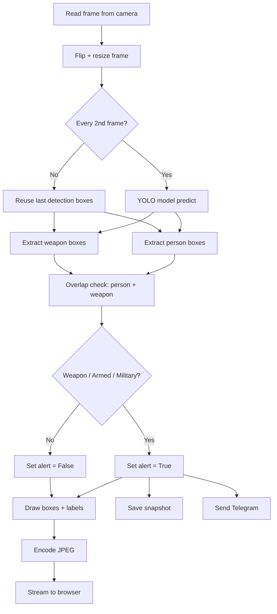
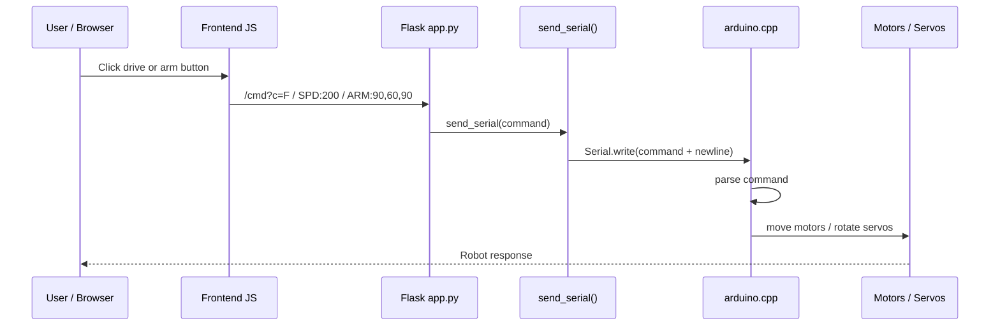
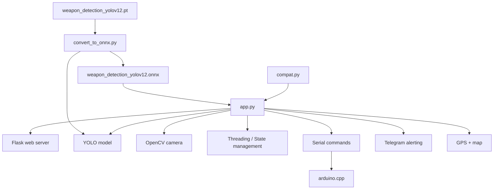

# Weapon Detection Surveillance Robot - ছাত্রদের জন্য সহজ ব্যাখ্যা

এই প্রজেক্টটি মূলত একটা "AI + Robotics + Web Dashboard" সিস্টেম।

তার মানে:
- ক্যামেরা থেকে ভিডিও আসে
- AI মডেল দেখে: "এখানে অস্ত্র আছে কি না?"
- যদি অস্ত্র/হুমকি পাওয়া যায়, সতর্কতা দেয়
- ওয়েব ব্রাউজার থেকে রোবটকে দূর থেকে নিয়ন্ত্রণ করা যায়
- Arduino রোবটের মোটর ও সার্ভো চালায়

এই ডকুমেন্টিটা দেখলে আপনি বুঝতে পারবেন:
- project শুরু থেকে শেষ পর্যন্ত কী কী কাজ করে
- কোন function কাকে call করে
- কোন ফাইলের কাজ কী
- কোন জায়গায় কী কারণে alert, snapshot, Telegram message, motor control ইত্যাদি হচ্ছে

---

## Diagram-Heavy Overview

### 1) Overall System Architecture

```mermaid
flowchart LR
    CAM[Camera / Webcam]
    CAP[app.py :: _capture_loop()]
    INF[app.py :: _inference_loop()]
    YOLO[YOLO Model]
    STATE[Shared State / detections / alert / gps]
    WEB[Flask Routes + HTML Dashboard]
    BROWSER[Browser UI]
    ARD[Arduino Board]
    MOTOR[Motors + Servos]
    S1[Snapshot Save]
    TG[Telegram Alert]
    MAP[GPS + Map]

    CAM --> CAP
    CAP --> STATE
    CAP --> INF
    INF --> YOLO
    YOLO --> STATE
    STATE --> WEB
    WEB --> BROWSER
    BROWSER -->|Commands| WEB
    WEB -->|Serial| ARD
    ARD --> MOTOR
    STATE --> S1
    STATE --> TG
    STATE --> MAP
```

### 2) Detection Pipeline Diagram



### 3) Browser to Arduino Control Flow



### 4) Alert Trigger Flow

```mermaid
flowchart TD
    A[YOLO detection result] --> B{Weapon detected?}
    B -- No --> C[Normal state]
    B -- Yes --> D[armed_now or military_now or weapons_now]
    D --> E[Set state["alert"] = True]
    E --> F[Update detections list]
    E --> G[Add event log]
    E --> H[Save snapshot image]
    E --> I[Send Telegram photo]
    E --> J[Show red alert banner in UI]
    J --> K[Browser sound + map marker update]
```

### 5) File Dependency Map



---

## 1. পুরো প্রকল্পের ছোট্ট ধারণা

এই প্রজেক্টের মূল উদ্দেশ্য:
1. নিরাপত্তা ক্যামেরা থেকে ভিডিও নেওয়া
2. YOLO AI model দিয়ে অস্ত্র/মানুষ/হুমকি খোঁজা
3. হুমকি দেখা গেলে সতর্কতা প্রকাশ করা
4. ওয়েব UI তে live video দেখা
5. রোবটের দিক/গতি/হাতে কাজ করা
6. Arduino-এর মাধ্যমে মোটর ও সার্ভো চালানো

সুতরাং এটি শুধু "চিত্র শনাক্তকরণ" নয়; এটি হলো:
- Computer Vision
- Embedded/Robotics
- Flask Web App
- Serial Communication
- Real-time Alerting
- Control Dashboard

এই সব একসাথে কাজ করে।

---

## 2. ফাইলভিত্তিক কাজের তালিকা

### app.py
এটি মূল brain of the project.

এখানে আছে:
- Flask server
- Camera capture loop
- YOLO inference loop
- State management
- Alert logic
- Serial communication to Arduino
- Web API endpoints
- HTML dashboard markup and JS

### arduino.cpp
এটি Arduino-board-এর firmware.

এখানে আছে:
- মোটর চালানোর logic
- সার্ভো (arm) নিয়ন্ত্রণ
- Serial command parsing
- forward/backward/left/right/stop
- gripper open/close
- safety watchdog

### compat.py
এটি platform-aware helper.

এখানে কাজ করে:
- Windows/ Linux/ Raspberry Pi অনুযায়ী মডেল path বাছাই করা
- ONNX বা .pt model খোঁজা

### convert_to_onnx.py
এটি YOLO PyTorch modelকে ONNX-এ রূপান্তর করে।

কারণ:
- ONNX CPU inference অনেক দ্রুত
- Raspberry Pi-তে performance ভালো থাকে

---

## 3. প্রজেক্টের পুরো flow (start to end)

```mermaid
flowchart TD
    A[Browser opens /] --> B[Flask index() loads HTML dashboard]
    B --> C[JavaScript starts polling /detections and /video_feed]
    C --> D[generate_frames() streams MJPEG video]
    E[Camera capture thread _capture_loop()] --> F[Latest frame saved in _capture_frame]
    F --> G[_inference_loop() reads frame]
    G --> H[YOLO model predicts boxes]
    H --> I[person + weapon overlap check]
    I --> J{Weapon or armed person detected?}
    J -- Yes --> K[Set alert state, save snapshot, Telegram alert]
    J -- No --> L[Continue normal loop]
    M[Browser control buttons] --> N[/cmd endpoint]
    N --> O[send_serial() sends command to Arduino]
    O --> P[arduino.cpp parses command]
    P --> Q[Motor/servo moves]
    K --> R[Dashboard updates with detections, map, alert details]
```

---

## 4. প্রজেক্ট শুরু হলে কী ঘটে?

### 4.1 app.py চালু হলে

app.py শুরু হয় এবং নিচের কাজগুলো শুরু হয়:

- Flask app তৈরি হয়
- model নির্বাচন হয়
- YOLO model লোড হয়
- camera open করার চেষ্টা হয়
- serial port Arduino-এর জন্য খোঁজা হয়
- background threads শুরু হয়

এখানে কিছু গুরুত্বপূর্ণ variables থাকে:

- MODEL_PATH: ব্যবহারযোগ্য model file
- CONTROL_PASSWORD: web control password
- SERIAL_BAUD = 9600
- CAMERA_INDEX: ক্যামেরার index
- state: detection, alert, FPS, GPS, events, view_mode ইত্যাদি

---

## 5. model কীভাবে বেছে নেয়?

`compat.py`-এ `resolve_model_path()` ফাংশন আছে।

এটি এইভাবে কাজ করে:

1. প্রথমে `weapon_detection_yolov12.onnx` খুঁজে
2. না পেলে `weapon_detection_yolov12.pt` খুঁজে
3. কোনোটি না পেলে প্রথম candidate path return করে

এটা গুরুত্বপূর্ণ কারণ:
- ONNX model faster
- PyTorch model fallback

তাই project self-healing ভাবে model বেছে নেয়।

---

## 6. YOLO model কীভাবে তৈরি হয়?

`convert_to_onnx.py`-এ `YOLO(PT_MODEL)` load করে এবং `model.export(format='onnx')` করে।

তার মানে:
- PyTorch model থেকে ONNX model বানানো হয়
- ONNX Runtime CPU-এ দ্রুত চলে
- app.py-তে এই ONNX model ব্যবহার করা হয়

সুতরাং:
- `weapon_detection_yolov12.pt` = source model
- `weapon_detection_yolov12.onnx` = optimized model

---

## 7. ক্যামেরা কীভাবে কাজ করে?

### _capture_loop()

এই function camera frame read করে।

কাজের ধাপ:
1. OpenCV `cv2.VideoCapture()` দিয়ে ক্যামেরা open করে
2. Windows/Linux অনুযায়ী backend choose করে
3. frame read করে
4. ` _capture_frame `-এ রেখে দেয়

এই অংশটি গুরুত্বপূর্ণ কারণ:
- capture thread আলাদা
- inference thread আলাদা

এটা করলে inference block হয় না, camera read কখনো stall করে না।

### কেন আলাদা thread?

কারণ:
- camera read করতে একটু সময় লাগে
- YOLO inferenceও সময় নেয়
- যদি একই thread-এ হয়, UI ও inference both slow হয়ে যাবে

সুতরাং:
- capture thread: frame নেওয়া
- inference thread: AI analyze করা
- web stream: pre-encoded JPEG শেয়ার করা

---

## 8. AI inference কীভাবে হয়?

### _inference_loop()

এই function মূল AI processing-এ কাজ করে।

### ধাপগুলো:

1. `_capture_frame` থেকে latest frame নিয়ে আসে
2. frame flip করে (mirror view)
3. `skip_ctr` অনুযায়ী প্রতি 2 frame পর inference চালায়
4. `model.predict(frame, conf=conf, imgsz=_INFER_SIZE)` executes করে
5. YOLO boxes, class names, confidence values বের করে
6. weapon boxes আর person boxes আলাদা করে
7. overlap check করে দেখে কোন person-এর সাথে weapon overlap আছে কি না
8. detection boxes হাতে drawing করে
9. alert state update করে
10. MJPEG stream buffer-এ encode করে রাখে

### এখানে important idea:

`_INFER_EVERY = 2` মানে:
- প্রতি 2 ফ্রেমে একবার inference
- মাঝখানের ফ্রেমে পুরনো box reuse করা হয়
- performance better হয়

---

## 9. "armed person" আর "military personnel" কিভাবে বোঝায়?

এখানে logic আছে:

### WEAPON_CLASSES
```python
WEAPON_CLASSES = {"gun", "pistol", "rifle", "knife", "Knife", "weapon", "guns"}
```

### MILITARY_WEAPON_CLASSES
```python
MILITARY_WEAPON_CLASSES = {"rifle", "gun", "guns"}
```

### overlap logic
`boxes_overlap(pbox, wbox)` ফাংশন দিয়ে দেখা হয়:
- কোন person box আর কোন weapon box overlap করছে কি না

তারপর:
- overlap + rifle/gun => military personnel
- overlap + weapon => armed person
- overlap না => normal person

### উদাহরণ
- এক ব্যক্তি + gun => "armed person"
- এক ব্যক্তি + rifle => "military personnel"
- weapon standalone => weapon class (gun / knife / pistol)

এইটাই project-এর core intelligence.

---

## 10. alert কীভাবে trigger হয়?

`_inference_loop()`-এ:

```python
is_alert = bool(weapons_now or armed_now or military_now)
```

এর মানে হলো:
- weapon আছে,
- অথবা armed person আছে,
- অথবা military personnel আছে

অর্থাৎ, কোনো একটাও পাওয়া গেলে alert logic activate হয়।

যদি alert হয়, তখন এই কাজগুলো ঘটে:

1. `state["alert"] = True` সেট হয়
2. detection list update হয়
3. `state["events"]`-এ alert log যোগ হয়
4. GPS থাকলে alert marker map-এ বসে
5. `snapshots/` ফোল্ডারে snapshot save হয়
6. Telegram bot-এ photo alert পাঠানো হয়
7. UI-তে red banner, sound, and alert count update হয়

### alert trigger chain

```text
weapon/person detected
   -> is_alert = True
   -> set state
   -> add event log
   -> save snapshot
   -> Telegram send
   -> browser UI update
```

---

## 11. Flask web app কী কী route করে?

### `/`
প্রধান HTML dashboard load করে।

### `/video_feed`
MJPEG stream পাঠায়।

### `/detections`
JSON-এ detection data পাঠায়:
- detection list
- FPS
- alert status
- total weapons
- persons
- military count

### `/set_conf`
confidence threshold update করে।

### `/location`
GPS position receive করে।

### `/gps_markers`
alert markers JSON ফেরত দেয়।

### `/unlock`
control password verify করে।

### `/serial_status`
Arduino connection status check করে।

### `/serial_reconnect`
Arduino reconnect করতে সাহায্য করে।

### `/cmd`
browser থেকে Arduino command পাঠায়।

### `/set_view`
night/thermal/gray view mode change করে।

### `/snapshots/<filename>`
saved alert image return করে।

### `/gallery`
alert images gallery দেখায়।

### `/events.csv`
CSV export দেয়।

---

## 12. Browser আর Arduino কীভাবে যোগাযোগ করে?

Browser dashboard থেকে user button click করলে JS fetch(`/cmd?c=...`) পাঠায়।

উদাহরণ:
- `F` = forward
- `B` = backward
- `L` = left
- `R` = right
- `W` = stop
- `ARM:90,60,90` = arm position command
- `SPD:200` = speed change
- `O` = gripper open
- `C` = gripper close

এই commands Flask route `cmd()`-এ পড়ে এবং `send_serial()` কল করে।

`send_serial()` Arduino serial port-এ newline-সহ command পাঠায়।

Arduino `arduino.cpp`-এ `processLine()`/`handleArmCommand()`/`handleSpeedCommand()` ইত্যাদি দিয়ে parse করে।

---

## 13. Arduino firmware কী কী করে?

`arduino.cpp`-এ motor driver pin, servo pin, watchdog, motor logic, speed map ইত্যাদি থাকে।

### মূল কাজ:
- left/right motor control
- forward/backward/diagonal moves
- speed control via PWM
- base elbow gripper servo control
- continuous rotation gripper open/close
- watchdog for safety

### Example
- `forward()` => both motors move forward
- `turnLeft()` => left motor stop/right motor move
- `startGripperClose()` => gripper servo rotates close direction for fixed time
- `updateGripper()` => non-blocking timer দিয়ে gripper status update করে

Arduino code-ne non-blocking loop design করেছে, যাতে command processing কখনো motor controlকে delay না করে।

---

## 14. project-এর end-to-end example

ধরুন user camera-তে একজন মানুষ দেখাচ্ছে, তার হাতে gun আছে।

### কী হবে?

1. Camera frame `_capture_loop()`-এ পড়বে
2. `_inference_loop()`-এ YOLO model run হবে
3. person box আর gun box overlap হবে
4. overlap detected => armed person
5. `state["alert"] = True`
6. red banner UI-তে দেখাবে
7. detection list-এ "armed person" ও gun দেখাবে
8. map-এ alert marker add হবে (GPS থাকলে)
9. snapshot save হবে `snapshots/alert_...jpg`
10. Telegram bot-এ alert photo send হবে
11. browser-side JS alerts and sounds trigger করবে

---

## 15. project-এর technical architecture summary

### Component responsibilities

| Component | Role |
|---|---|
| `app.py` | Main application logic |
| `compat.py` | Model path resolution |
| `convert_to_onnx.py` | Convert PT → ONNX |
| `arduino.cpp` | Hardware control on Arduino |
| `Flask routes` | Web API and UI endpoints |
| `YOLO model` | Detect objects in frames |
| `OpenCV` | Camera, drawing, JPEG conversion |
| `Threading` | Separate capture and inference |
| `Telegram` | Real-time alerting |
| `GPS + Leaflet` | Location tracking and tactical map |

---

## 16. ছোট সারাংশ

এই project-এ AI, web, robotics, and hardware একসাথে কাজ করে।

আমরা মূলত এভাবে চিন্তা করতে পারি:

- `camera` -> frame capture
- `AI model` -> detect weapon/person
- `state manager` -> keep status and alerts
- `web dashboard` -> show live video + detections
- `serial interface` -> send motor commands
- `Arduino` -> drive motors and servos
- `Telegram + snapshot + GPS` -> alerting and tracking

এক কথায়:

"ক্যামেরা থেকে ভিডিও নিয়ে AI সেগুলো দেখে, হুমকি শনাক্ত করে, UI-তে দেখায়, আর Arduino-এর মাধ্যমে robotic platform নিয়ন্ত্রণ করে।"

---

## 17. শেষ কথা

এই projectটি শিখতে হলে সবচেয়ে গুরুত্বপূর্ণ বিষয় হলো:
- File responsibilities বোঝা
- Function dependency বোঝা
- Threading কেন দরকার তা বোঝা
- AI model detection pipeline বোঝা
- Browser to Flask to Arduino flow বোঝা

যদি আপনি এই 5টি জিনিস ভালোভাবে বোঝেন, তাহলে পুরো project-এর logic আপনার কাছ থেকে খুব সহজে বুঝে যাবে।

---

## 18. quick call chain (very short)

```text
Browser JS
   -> /cmd
   -> Flask app.py
   -> send_serial()
   -> Arduino serial port
   -> arduino.cpp parse and move motor/servo
```

```text
Camera
   -> _capture_loop()
   -> _capture_frame
   -> _inference_loop()
   -> YOLO predict
   -> alert + snapshot + Telegram + UI update
```

এটাই এই project-এর মূল idea.

---
